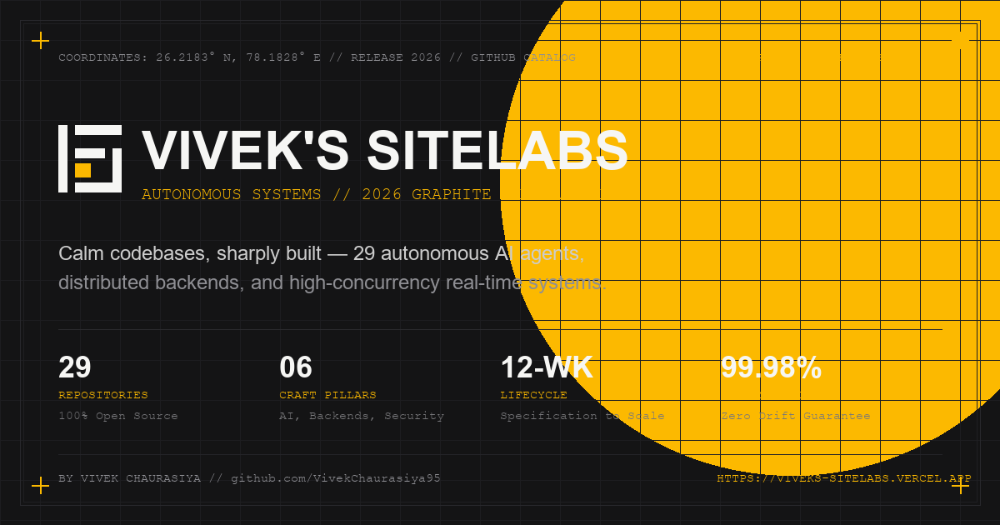
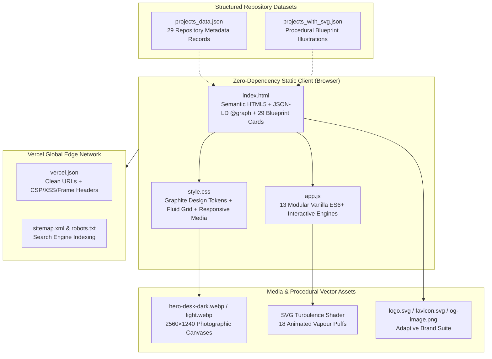

<div align="center">

<!-- Animated Architectural Hero Banner -->
<a href="https://viveks-sitelabs.vercel.app/" target="_blank">
  
</a>

<br />

<!-- Animated Typing Telemetry Headline -->
<a href="https://viveks-sitelabs.vercel.app/" target="_blank">
  
</a>

<br />

<!-- Status & Tech Badges -->
<p>
  <a href="https://viveks-sitelabs.vercel.app/" target="_blank"></a>
  <a href="https://github.com/VivekChaurasiya95/Vivek-SiteLabs/stargazers"></a>
  <a href="./LICENSE"></a>
  
  
</p>

<p>
  
  
  
  
  
</p>

<p>
  <a href="#-visual-showcase"><b>Showcase</b></a> &nbsp;·&nbsp;
  <a href="#-core-interactive-systems"><b>Interactive Systems</b></a> &nbsp;·&nbsp;
  <a href="#-graphite-design-system"><b>Design Tokens</b></a> &nbsp;·&nbsp;
  <a href="#-architecture-overview"><b>Architecture</b></a> &nbsp;·&nbsp;
  <a href="#-complete-29-repository-blueprint-catalog"><b>29 Projects</b></a> &nbsp;·&nbsp;
  <a href="#-developer-terminal-sandbox"><b>CLI Sandbox</b></a> &nbsp;·&nbsp;
  <a href="#-quick-start--deployment"><b>Quick Start</b></a>
</p>

</div>


## ✦ Executive Overview

**Vivek's SiteLabs** is an editorial, architectural, and zero-dependency **Engineering Showcase Hub** engineered in the signature aesthetic of the [Graphite Specification](https://template-preview.com/wordpress/graphite/). It catalogs and benchmarks all **29 public open-source repositories** built by [Vivek Chaurasiya](https://github.com/VivekChaurasiya95?tab=repositories) — spanning **Autonomous Multi-Agent AI**, **RAG Pipelines**, **Distributed Backend Engines**, **Full-Stack Workspaces**, **Security Tooling**, and **Civic-Tech Applications**.

Rather than relying on heavy frontend frameworks or external animation libraries, SiteLabs runs on a **hand-crafted Vanilla ES6+ motion engine**, custom **SVG turbulence shaders**, **precision CSS Grid coordinate math**, and **static Vercel Edge delivery** — achieving near-instant load times, zero runtime overhead, and complete responsiveness from `320px` mobile screens up to `2560px` ultrawide displays.

---

## ✦ Visual Showcase

<div align="center">

<table>
  <tr>
    <td align="center" width="50%">
      <br />
      <sub><b>Signature Graphite Dark Canvas</b> (<code>#2e2e30</code>) with Live Coffee Steam SVG Filter</sub>
    </td>
    <td align="center" width="50%">
      <br />
      <sub><b>Architectural Paper Light Canvas</b> (<code>#f6f6f4</code>) with Instant Theme Switching</sub>
    </td>
  </tr>
  <tr>
    <td align="center" colspan="2">
      <br />
      <sub><b>Social & OpenGraph Brand Card</b> (<code>1200×630</code>) — Embedded across LinkedIn, X/Twitter, and Discord</sub>
    </td>
  </tr>
</table>

</div>


## ✦ Core Interactive Systems

Every interaction in `app.js` is modularized into **13 dedicated zero-dependency engines**:

| Index | Module | Technical Implementation & Experience |
| :---: | :--- | :--- |
| **00** | **Navbar Glider & Scrollspy** | Floating pill glider (`#navGlider`) smoothly tracks the active navigation link via `IntersectionObserver` and dynamic `getBoundingClientRect()` geometry, paired with a full-screen slide-out **Mobile Navigation Drawer** (`Esc` & backdrop dismissible). |
| **01** | **Dual Theme Engine** | Instantaneous switching between **Authentic Graphite Dark** (`#2e2e30`) and **Architectural Paper Light** (`#f6f6f4`) persisted in `localStorage`, dispatching custom `graphite:theme` events to synchronize SVG steam opacity and hero canvases. |
| **02** | **Live Coffee Steam Shader** | Procedural SVG filter pipeline (`<feTurbulence>` + `<feDisplacementMap>` + `<feGaussianBlur>`) animating 18 buoyant vapour puffs locked mathematically to the espresso cup coordinates `[370, 1102]` on the `2560×1240` desk canvas. |
| **03** | **Hero Studio Parallax** | Hardware-accelerated `translate3d` RAF interpolation loop giving subtle depth to the viewfinder studio frame (`┌ ┐ └ ┘`) on desktop pointers while gracefully disabling on coarse touch screens. |
| **04** | **IST Live Telemetry Clock** | Real-time New Delhi (`Asia/Kolkata`) monospaced tabular clock updating in sync with local engineering studio telemetry. |
| **05** | **Magnetic Custom Cursor** | Dual-layer pointer tracker with smooth lerp trailing ring and magnetic amber expansion over interactive cards, chips, and terminal controls. |
| **06** | **10-Slot Mechanical Odometer** | Precision flex-column digit drums (`0`–`9`, exact `1.15em` slot height, `-10%` step transforms) with staggered wheel delays (`cellIdx * 50ms + digitIdx * 80ms`), `cubic-bezier(0.16, 1, 0.3, 1)` deceleration, and **click-to-respin** triggers. |
| **07** | **Six Crafts Expanding Accordion** | Auto-playing 6-pillar showcase with real-time progress bar (`.sv__prog`), pause/play toggle (`.gr-pause`), and 3D mouse perspective tilt (`--px`, `--py`). |
| **08** | **Blueprint Crosshair & HUD** | Live coordinate telemetry tracker rendering `X 0480 · Y 0620 · CELL B2` while illuminating column (`A`–`D`) and row (`1`–`8`) architectural guide bands across all 29 project cards. |
| **09** | **Blueprint Inspector Drawer** | Slide-over deep-inspection modal featuring full architectural summaries, tech stack tags, live benchmarks, 1-click `git clone` copy-to-clipboard, and direct GitHub/Demo launchers. |
| **10** | **12-Week Sprint Timeline** | Continuous scrubbable lifecycle timeline with draggable playhead, keyboard arrow navigation, milestone markers, and synchronized active engineering roles. |
| **11** | **System Matrix Filter Table** | Fast domain/language filterable engineering audit matrix for instant repository comparison. |
| **12** | **Developer Terminal Sandbox** | Embedded interactive CLI emulator supporting directory listings, repository inspection, domain filtering, live statistics, and clone generation. |


## ✦ Graphite Design System

### Color Token Matrix

<table>
  <thead>
    <tr>
      <th>Token</th>
      <th>Dark Mode (Graphite Matte Slate)</th>
      <th>Light Mode (Architectural Paper)</th>
      <th>Architectural Role</th>
    </tr>
  </thead>
  <tbody>
    <tr>
      <td><code>--bg</code></td>
      <td> <code>#2e2e30</code></td>
      <td> <code>#f6f6f4</code></td>
      <td>Primary Canvas Surface</td>
    </tr>
    <tr>
      <td><code>--doc-bg</code></td>
      <td> <code>#242426</code></td>
      <td> <code>#ffffff</code></td>
      <td>Elevated Blueprint Frames &amp; Drawers</td>
    </tr>
    <tr>
      <td><code>--fg</code></td>
      <td> <code>#f4f4f2</code></td>
      <td> <code>#161617</code></td>
      <td>Primary Titanium Ink / Typography</td>
    </tr>
    <tr>
      <td><code>--accent-amber</code></td>
      <td colspan="2" align="center"> <code>#fcb900</code></td>
      <td>Active Progress Gauges, Cursor Highlight &amp; Telemetry</td>
    </tr>
    <tr>
      <td><code>--accent-green</code></td>
      <td colspan="2" align="center"> <code>#7bdcb5</code></td>
      <td>Live Operational Status &amp; Terminal Prompts</td>
    </tr>
    <tr>
      <td><code>--accent-blue</code></td>
      <td colspan="2" align="center"> <code>#00d2ff</code></td>
      <td>AI Inference &amp; Coordinate Indicators</td>
    </tr>
  </tbody>
</table>

### Typography & Motion Curves

- **Display Sans (`--sans`)**: [`Manrope`](https://fonts.google.com/specimen/Manrope) (Weights `400`–`800`) — Geometric, high-contrast headlines scaling fluidly via `--u: calc(100vw / 2560)` and CSS `clamp()`.
- **Editorial Serif (`--serif`)**: [`Instrument Serif`](https://fonts.google.com/specimen/Instrument+Serif) (Italic) — Sharp typographic contrast for italicized emphasis (`Twenty-nine projects, in numbers.`, `One developer.`).
- **Telemetry Mono (`--mono`)**: [`JetBrains Mono`](https://fonts.google.com/specimen/JetBrains+Mono) (`tnum`, `zero`) — Tabular figures for rolling odometers, grid coordinates, blueprint axes, and CLI output.
- **Physics Easing Tokens**:
  - `--settle`: `cubic-bezier(.2, .85, .25, 1)` — Tactile UI snapping
  - `--expand`: `cubic-bezier(.7, 0, .2, 1)` — Accordion & drawer transitions
  - `--smooth`: `cubic-bezier(.16, 1, .3, 1)` — Fluid mechanical odometer deceleration


## ✦ Architecture Overview



### Repository Structure

```text
Vivek-SiteLabs/
├── index.html                  # Semantic HTML5 hub, Schema.org JSON-LD @graph, 29 project blueprints
├── style.css                   # Full Graphite 2026 design system, dark/light tokens, responsive grid
├── app.js                      # 13-module vanilla ES6+ interactive motion, HUD, odometer & CLI engine
├── projects_data.json          # Structured JSON catalog of all 29 GitHub repositories
├── projects_with_svg.json      # Extended dataset with custom procedural SVG blueprint schematics
├── logo.svg                    # Primary vector brand monogram for Vivek's SiteLabs
├── logo-showcase.html          # Standalone brand logo inspection & presentation sheet
├── hero-desk-dark.webp         # 2560×1240 dark matte graphite studio desk photography
├── hero-desk-light.webp        # 2560×1240 light architectural studio desk photography
├── hero-desk-dark-1000.webp    # Mobile-optimized hero desk canvas
├── og-image.png                # 1200×630 OpenGraph / Twitter social preview banner
├── favicon.svg / .ico          # Adaptive vector & legacy multi-size favicon suite
├── apple-touch-icon.png        # 180×180 iOS home-screen icon
├── vercel.json                 # Clean URLs & strict HTTP security headers for Edge deployment
├── robots.txt                  # Crawler directives & sitemap discovery
├── sitemap.xml                 # Canonical XML sitemap for search engines
├── assets/                     # Animated SVG banners & architectural dividers for GitHub README
└── LICENSE                     # MIT License (Copyright © 2026 Vivek Chaurasiya)
```


## ✦ Complete 29-Repository Blueprint Catalog

All **29 production & experimental systems** featured in SiteLabs are sourced directly from [`github.com/VivekChaurasiya95`](https://github.com/VivekChaurasiya95?tab=repositories):

| Metric Cell | Domain Breakdown | Shipped Count |
| :---: | :--- | :---: |
| **`A1`** | **Total Web & Software Repositories** | **`029`** |
| **`B1`** | **Multi-Agent AI & RAG Systems** | **`008`** |
| **`C1`** | **Distributed Engines & Daemons** | **`006`** |
| **`D1`** | **Full-Stack Workspaces, Security & Civic Apps** | **`015`** |

<details open>
<summary><b>Click to expand / collapse full Blueprint Matrix [A1 – A8]</b></summary>

<br />

| Grid | Repository | Domain | Primary Stack | Benchmark / Highlight |
| :---: | :--- | :--- | :--- | :--- |
| **`A1`** | [**Meridian-AI**](https://github.com/VivekChaurasiya95/Meridian-AI) | Multi-Agent AI | `Python` | `META HACKATHON · MULTI-AGENT` |
| **`B1`** | [**AstraFinance-AI**](https://github.com/VivekChaurasiya95/AstraFinance-AI) | Multi-Agent AI | `TypeScript` | `FIN-RESEARCH · CHROMADB + GROQ` |
| **`C1`** | [**DIME-Sem5**](https://github.com/VivekChaurasiya95/DIME-Sem5) | Multi-Agent AI | `TypeScript` | `LIVE MARKET RAG · QDRANT` |
| **`D1`** | [**AlgoFight**](https://github.com/VivekChaurasiya95/AlgoFight) | Distributed Backend | `JavaScript` | `PROD ARENA · MITS GWALIOR` |
| **`A2`** | [**StudyOS_Vivek**](https://github.com/VivekChaurasiya95/StudyOS_Vivek) | Full-Stack | `JavaScript` | `MERN WORKSPACE · LIGHT/DARK` |
| **`B2`** | [**Student-Saarthi**](https://github.com/VivekChaurasiya95/Student-Saarthi) | Full-Stack | `HTML / JS` | `SCHOLARSHIP HUB · ANTIDEPLOY` |
| **`C2`** | [**Synapze**](https://github.com/VivekChaurasiya95/Synapze) | Full-Stack | `JavaScript` | `P2P MIND-SPACE · REALTIME` |
| **`D2`** | [**AegisVault**](https://github.com/VivekChaurasiya95/AegisVault) | Security & DevTools | `TypeScript` | `ZERO-KNOWLEDGE · AES-256` |
| **`A3`** | [**hser-project**](https://github.com/VivekChaurasiya95/hser-project) | Multi-Agent AI | `JavaScript` | `SKILL DECAY AI MODEL` |
| **`B3`** | [**BhojSetu**](https://github.com/VivekChaurasiya95/BhojSetu) | Full-Stack | `Full-Stack` | `MULTILINGUAL CATERING PLATFORM` |
| **`C3`** | [**JanRide**](https://github.com/VivekChaurasiya95/JanRide) | Civic & Exp | `Dart / Flutter` | `LAST-MILE TRANSIT · FLUTTER` |
| **`D3`** | [**ChronOS-Vivek**](https://github.com/VivekChaurasiya95/ChronOS-Vivek) | Civic & Exp | `Python` | `CIVIC-TECH · GSOC HUB` |
| **`A4`** | [**SkillFlare-Vivek**](https://github.com/VivekChaurasiya95/SkillFlare-Vivek) | Civic & Exp | `TypeScript` | `SKILL BENCHMARK · DELTA` |
| **`B4`** | [**AnimateItNow-Vivek**](https://github.com/VivekChaurasiya95/AnimateItNow-Vivek) | Civic & Exp | `HTML / CSS` | `CSS ANIM ENGINE · NETLIFY` |
| **`C4`** | [**gh-space-shooter**](https://github.com/VivekChaurasiya95/gh-space-shooter) | Civic & Exp | `Python` | `SPACE SHOOTER · CONTRIBUTION 3D` |
| **`D4`** | [**codex**](https://github.com/VivekChaurasiya95/codex) | Distributed Backend | `Python / CLI` | `TERMINAL AI AGENT` |
| **`A5`** | [**MIMIR**](https://github.com/VivekChaurasiya95/MIMIR) | Multi-Agent AI | `Python` | `OBSERVABILITY & INFERENCE` |
| **`B5`** | [**CortexFlow-Vivek**](https://github.com/VivekChaurasiya95/CortexFlow-Vivek) | Distributed Backend | `JavaScript` | `STATE STREAMING PIPELINE` |
| **`C5`** | [**Linux-Telemetry**](https://github.com/VivekChaurasiya95/Linux-Telemetry) | Distributed Backend | `C / Python` | `KERNEL OBSERVABILITY DAEMON` |
| **`D5`** | [**GearGuard-Vivek**](https://github.com/VivekChaurasiya95/GearGuard-Vivek) | Full-Stack | `TypeScript` | `EQUIPMENT TELEMETRY & AUDIT` |
| **`A6`** | [**Agro-Vision**](https://github.com/VivekChaurasiya95/Agro-Vision) | Multi-Agent AI | `JavaScript` | `COMPUTER VISION AGRI-DIAGNOSIS` |
| **`B6`** | [**Vivek-PromptPilot-AI**](https://github.com/VivekChaurasiya95/Vivek-PromptPilot-AI) | Multi-Agent AI | `JavaScript` | `PROMPT OPTIMIZATION PIPELINE` |
| **`C6`** | [**Vivek-free-code**](https://github.com/VivekChaurasiya95/Vivek-free-code) | Distributed Backend | `TypeScript` | `UNSHACKLED CLAUDE RUNTIME` |
| **`D6`** | [**DIME**](https://github.com/VivekChaurasiya95/DIME) | Multi-Agent AI | `TypeScript` | `DATA-DRIVEN IDEA EXPLORATION` |
| **`A7`** | [**Portfolio**](https://github.com/VivekChaurasiya95/Portfolio) | Full-Stack | `TypeScript` | `MINIMALIST DESIGN PORTFOLIO` |
| **`B7`** | [**Keroween**](https://github.com/VivekChaurasiya95/Keroween) | Full-Stack | `JavaScript` | `HALLOWEEN HACKATHON PROJECT` |
| **`C7`** | [**decodelabs_tasks**](https://github.com/VivekChaurasiya95/decodelabs_tasks) | Security & DevTools | `Jupyter` | `DATA SCIENCE INTERNSHIP` |
| **`D7`** | [**Chai_aur_Code-js-hindi-youtube**](https://github.com/VivekChaurasiya95/Chai_aur_Code-js-hindi-youtube) | Security & DevTools | `JavaScript` | `JAVASCRIPT ENGINE LAB` |
| **`A8`** | [**VivekChaurasiya95**](https://github.com/VivekChaurasiya95/VivekChaurasiya95) | Civic & Exp | `Markdown` | `CORE GITHUB SPECIFICATION` |

</details>


## ✦ Developer Terminal Sandbox

SiteLabs ships with a built-in monospaced CLI (`#terminal`) so engineers can query Vivek's catalog directly from the keyboard:

```bash
vivek@sitelabs:~$ help
  ls | list              # List all 29 blueprint repositories & coordinates
  info | cat <repo>      # Inspect architecture, stack & metrics for a repo
  filter <domain>        # Filter catalog by domain (ai, backend, fullstack, security, civic)
  stats                  # Print live language distribution & repository audit summary
  clone <repo>           # Generate ready-to-run git clone command for any project
  clear                  # Clear terminal output buffer
```

---

## ✦ SEO, Responsiveness & Edge Security

- **Structured Data (`JSON-LD @graph`)**: Rich Schema.org definitions for `WebSite`, `Person` (`Vivek Chaurasiya`), and `ItemList` of `SoftwareSourceCode` items.
- **Social Graph Optimization**: Full OpenGraph (`1200×630`) + Twitter/X `summary_large_image` cards, canonical links, `robots.txt`, and `sitemap.xml`.
- **Responsive Viewport Engineering**: Zero horizontal overflow across mobile (`320px`–`600px`), tablet (`768px`–`1024px`), laptop (`1280px`–`1440px`), and ultrawide (`2560px`) viewports, with touch-friendly drawers and adaptive typography.
- **Hardened Edge Headers (`vercel.json`)**: Pre-configured `cleanUrls: true`, `X-Content-Type-Options: nosniff`, `X-Frame-Options: DENY`, and `X-XSS-Protection: 1; mode=block`.


## ✦ Quick Start & Deployment

Because **Vivek's SiteLabs** requires **no backend, no bundler, and zero npm packages**, you can run it locally or deploy it to Vercel's global edge network in seconds.

### 1. Clone & Run Locally

```bash
# Clone the repository
git clone https://github.com/VivekChaurasiya95/Vivek-SiteLabs.git
cd Vivek-SiteLabs

# Option A — Python 3 Built-in Server (Recommended)
python -m http.server 3000

# Option B — Node.js Zero-Config Server
npx serve . -l 3000
```

Open **`http://localhost:3000`** in any modern browser.

### 2. One-Click Static Edge Deployment

<div align="center">

[](https://vercel.com/new/clone?repository-url=https%3A%2F%2Fgithub.com%2FVivekChaurasiya95%2FVivek-SiteLabs)

</div>

> **Deployment Note:** This project is a **100% static frontend application** with `vercel.json` pre-configured. No backend server (such as Render) is needed — simply connect the repository to **Vercel** (or Netlify / GitHub Pages) and publish instantly.


## ✦ Author & License

<div align="center">

**Vivek Chaurasiya** — *Full-Stack Software Engineer & AI Systems Builder*

<p>
  <a href="https://github.com/VivekChaurasiya95"></a>
  <a href="https://vivek-chaurasiya.vercel.app"></a>
  <a href="https://viveks-sitelabs.vercel.app/"></a>
</p>

Licensed under the [**MIT License**](./LICENSE) — © 2026 Vivek Chaurasiya.

<br />



</div>
